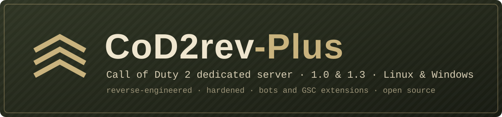

# CoD2rev-Plus

<p align="center"></p>

[](https://github.com/JotaJazz/CoD2rev-Plus/actions/workflows/build.yml)
[](LICENSE)


[](https://github.com/voron00/CoD2rev_Server)
[](https://github.com/JotaJazz/CoD2rev-Plus/commits/master)

**Español** · [English](README.md) · [Português](README.pt.md) · [Français](README.fr.md) · [Deutsch](README.de.md) · [Русский](README.ru.md)

Código fuente, obtenido por ingeniería inversa, del servidor dedicado de **Call of Duty 2** (versiones 1.0 y 1.3).
Corrige varios errores de los binarios originales y permite extender la funcionalidad del servidor.

Este repositorio es un fork de [voron00/CoD2rev_Server](https://github.com/voron00/CoD2rev_Server), que es donde está hecho todo el trabajo de ingeniería inversa. Aquí solo se añaden los cambios descritos en [Cambios de este fork](#cambios-de-este-fork).

## Transparencia

- **Quién mantiene esto:** soy JotaJazz. Me gustan los juegos antiguos y este fork existe por eso: quiero seguir pudiendo levantar un servidor de CoD2 en mis propias máquinas.
- **Cómo se trabaja aquí:** trabajo con [Claude Code](https://claude.com/claude-code), el asistente de programación de Anthropic. Los cambios de este fork, incluidos este README y sus traducciones, están escritos con su ayuda. Los commits hechos así llevan la línea `Co-Authored-By: Claude` en el mensaje, de modo que se pueden identificar en el historial con `git log`.
- **Relación con el original:** este fork trae cambios del repositorio original cuando los hay, pero no le envía los suyos. Es probable que con el tiempo se aleje de él.
- **Qué no es:** no es un proyecto oficial ni está afiliado a Activision, Infinity Ward ni al autor del repositorio original. No incluye ningún archivo del juego.

## Cambios de este fork

- **Compilación para Windows con MinGW** (32 bits), también cruzada desde Linux.
- **Contraseñas fuera del log:** `rcon_password` y `sv_privatePassword` se muestran como `********` en el registro de consola.
- **Bloqueo de rcon por intentos fallidos:** tras varias contraseñas incorrectas, la dirección IP queda ignorada por rcon durante un tiempo. Una contraseña correcta reinicia el contador y las direcciones `127.x.x.x` nunca se bloquean.
- **Master servers:**
  - `sv_master2` viene configurado con `master.cod2x.me`, el master de la comunidad CoD2x.
  - El formato `host:puerto` en `sv_master1`–`sv_master5` ahora funciona.
  - Un fallo de DNS se reintenta en vez de borrar el master.
- **Versión del juego seleccionable al compilar:** el servidor se puede compilar como 1.0 o como 1.3.
- **Corrección de un desbordamiento con clientes Game Pass:** enviar la información del sistema a un cliente con protocolo 119 podía desbordar un búfer y tumbar el servidor.
- **Mensajes grandes de clientes 1.3:** los mensajes fragmentados que enviaban los clientes 1.3 se leían mal y se descartaban; ahora se leen con el formato de 1.3.
- **Cadenas acotadas en las funciones de script de libcod:** `printf` y `sprintf` de libcod, las llamadas asíncronas de SQLite y exec y el renombrado de jugadores ya no escriben fuera de sus búferes cuando un script pasa cadenas largas.
- **Compilación más simple:** `make` genera directamente el binario Linux de 32 bits, `make windows` hace la compilación cruzada para Windows y GitHub Actions compila todas las variantes en cada push.
- **`server.cfg` de ejemplo:** `scripts/server.cfg.example` lista todas las variables que registra el servidor; `scripts/gen_server_cfg.py` lo regenera a partir del código.
- **`dedicated` se respeta:** `+set dedicated 1` se ignoraba y todos los servidores se anunciaban a los master servers. Ahora `1` mantiene el servidor fuera de la lista pública y `2`, el valor por defecto, lo anuncia.
- **Archivos del juego en discos de Windows:** la compilación de Linux no veía los archivos del juego en sistemas de archivos con números de inodo grandes, como los discos de Windows bajo WSL. Ahora se compila con desplazamientos de archivo de 64 bits.
- **Reloj de juego estable en Linux:** el servidor medía el tiempo con el reloj del sistema, así que cada corrección de hora (NTP, sincronización de una máquina virtual) congelaba la partida un instante. Ahora usa el reloj monotónico.
- **Entrada de red más robusta:** un jugador conectado podía hacer caer el servidor o sobrescribir su memoria con un mensaje comprimido demasiado grande, un mensaje fragmentado, un nombre con `%` (los modos de juego originales lo escriben en el log), `callvote clientkick` con un número negativo o paquetes de voz. Ahora esas rutas comprueban los límites, y se cierran los archivos de las descargas HTTP interrumpidas.
- **Bots tras un cambio de mapa:** al cambiar de mapa, los bots seguían conectados pero fuera de la partida, ocupando su slot, así que el mod de bots añadía otros hasta llenar el servidor. Ahora vuelven a la partida en cuanto carga el mapa nuevo.
- **Dirección del proxy de libcod y descargas:** la dirección real que un proxy local pasa en la clave `ip` del userinfo solo se acepta desde `127.0.0.1`, tiene que ser una IPv4 y se borra en cada conexión. Un `donedl` de un jugador que ya está en la partida ya no hace que el servidor reenvíe el gamestate completo.
- **Descargas y contraseñas:** la comprobación que debía impedir que los clientes descargaran las `iw_*.iwd` originales nunca coincidía, así que cualquier cliente podía bajarlas (cientos de MB cada una); ahora se rechazan, igual que las `.iwd` `_svr_` que son solo del servidor, también antes de una redirección HTTP. Las descargas ya no se quedan atascadas si el mapa cambia en medio, un mensaje de cliente demasiado grande para descomprimirse expulsa al cliente en vez de truncarse, y rcon, `g_password` y `sv_privatePassword` se comparan en tiempo constante.
- **Baneos, log de partida y otros arreglos encontrados en zk_libcod:** `addip` y `g_banIPs` guardaban una lista de direcciones baneadas que nadie consultaba; ahora se aplica al conectar, también a los jugadores que llegan por un proxy local. La última dirección de `g_banIPs` ya no se ignora, y un `addip` largo ya no desborda la pila. Los saltos de línea en mensajes de chat y nombres de jugador podían escribir líneas falsas en `games_mp.log` y partir las respuestas de `getstatus`; ahora se eliminan. Una contraseña de rcon incorrecta ya no retrasa la correcta, un `userinfo` ya no se traga el siguiente mensaje de chat, y mantener el botón de granada sin granadas ya no oculta a los demás los disparos y pasos del jugador. Las entidades de efecto de las explosiones de granada ahora se liberan en vez de acumularse hasta el fin del mapa, un script que borra una ametralladora fija en uso ya no termina el mapa, y un nombre de mapa largo pasado a una función de script ya no detiene el servidor.
- **Informes de crash:** cuando el servidor se cae, escribe la señal o excepción, la dirección del fallo y las direcciones de las llamadas en la consola y en `crash.log` dentro de `fs_homepath`. `addr2line -f -e <binario> <dirección>` las convierte en ubicaciones del código. En Linux el proceso termina después con la misma señal que antes, así que los core dumps siguen funcionando.
- **Opciones de log y administración:** el log de consola puede cambiar de nombre (`logfileName`), conservar los logs de ejecuciones anteriores (`logfileRotate`) y empezar cada línea con la fecha y hora (`logTimestamps`). Los comandos rcon aceptados pueden quedar fuera del log (`sv_logRcon`), el servidor de autorización de CD keys se puede cambiar (`sv_authorizeServer`, `sv_authorizePort`), el servidor puede imponer una tasa y una frecuencia de snapshots a todos los clientes (`g_forceRate`, `g_forceSnaps`), y los mensajes que anuncian una expulsión o un timeout se pueden apagar (`sv_kickMessages`, `sv_timeoutMessages`). Los nombres son los mismos que en zk_libcod, así que sus configs siguen sirviendo.
- **Más callbacks y métodos de jugador de libcod (de zk_libcod, mismos nombres):** `_callbacksetup.gsc` puede definir `CodeCallback_Error(critical, function, message)` (errores de runtime de scripts, entregados en el frame siguiente), `CodeCallback_HitchWarning(msec)`, `CodeCallback_Pickup(type, weapon, name, quantity, clip, origin, angles)` (reemplaza la recogida original), `CodeCallback_Suicide()` (reemplaza `suicide()`; `processSuicide()` mata), `CodeCallback_WeaponChange(index, name)` y un callback por cada botón presionado: `Attack`, `Melee`, `Use`, `Reload`, `LeanLeft`, `LeanRight`, `Prone`, `Crouch`, `Stand`, `Ads`, `MeleeBreath`, `HoldBreath`, `Frag` y `Smoke` (`CodeCallback_<nombre>Button()`). Métodos de jugador nuevos: `isFiring`, `isMeleeing`, `isReloading`, `isThrowingGrenade`, `isUsingBinoculars`, `isRechambering`, `isShellShocked`, `isChatting`, `holdBreathButtonPressed`, `get`/`setCurrentWeaponAmmo`, `get`/`setCurrentWeaponClipAmmo`, `getCurrentWeaponSlot`, `get`/`setSpeed`, `get`/`setGravity`, `getGroundEntity`, `getViewOrigin`, `getPlayerstateFlags`, `getInactivityTime`, `getEnterTime` y `processSuicide`. A diferencia de zk_libcod, los callbacks de cambio de arma y de error nunca corren dentro del movimiento del jugador ni de la VM de scripts, y un `suicide()` dentro de `CodeCallback_Suicide` no entra en bucle.
- **Grafos de waypoints con A\* y más funciones de script (de zk_libcod):** `graphCreate`, `graphAddNode`, `graphAddEdge`, `graphFindPath`, `graphFindClosestNode`, `graphAutodiscover`, `graphSave`/`graphLoad` y el resto de las funciones `graph*` de zk_libcod permiten que los scripts de bots naveguen un mapa (`src/libcod/gsc_graph.cpp`, portado bajo su licencia MIT). A diferencia de zk_libcod, los grafos también se borran en un `map_restart` rápido (cada ronda de SD), un id o archivo inválido devuelve undefined sin terminar el thread del script, `graphLoad` rechaza archivos de más de 64 MB y `graphSave` rechaza nombres `.iwd`, `.cfg` y `.gsc`. También son nuevas: `abs`, `floor`, `ceil`, `pow`, `atan2`, `roundTo`, `getMilliseconds`, `getMicroseconds`, `toHex`, `fromHex`, `ord`, `chr`, `getEntityCount`, `logPrintConsole` y los métodos `getUserinfo`/`setUserinfo`; `bulletTrace` y `bulletTracePassed` aceptan una máscara de contenidos opcional, y `bulletTrace` también devuelve `flags`, `contents` y `material`; con `sv_botUseTriggerUse 1`, un bot parado en un trigger de uso (como una zona de bomba de SD) recibe `self waittill("bot_trigger", trigger)`.
- **Prueba de humo:** `scripts/smoke_test.py` arranca el servidor de Linux con una carpeta real del juego y comprueba que carga un mapa, responde a las consultas y deja entrar a un cliente mínimo (`scripts/cod2client.py`) que recibe el gamestate, entra en la partida y envía comandos, también en mensajes fragmentados.
- **Bots sencillos:** `mods/bots` es un pequeño mod de scripts cuyos bots caminan hacia el enemigo más cercano y disparan a lo que ven, usando las funciones de bots de libcod. No usan puntos de ruta. `scripts/install_bots.py` lo instala; `bots_count` y `bots_skill` los controlan.
- **Más botones para los bots en libcod:** los métodos de script `useButton`, `throwSmoke` y `holdBreath` hacen que un bot pulse usar (para plantar o desactivar la bomba), lance una granada de humo o aguante la respiración, igual que los ya existentes `fireWeapon` y `throwNade`. Reciben `1` para pulsar y `0` para soltar.
- **Menos bloqueos y un arranque más limpio:** el nombre del master server se resuelve una sola vez en lugar de en cada espera de autorización agotada, y el servidor ya no avisa por cada `+set` de la línea de comandos.
- **Lanzadores:** `scripts/windows/iniciar_cod2rev.bat` y `scripts/linux/iniciar_cod2rev.sh`, con un modo LAN y un modo internet.

### Variables nuevas

| Variable | Por defecto | Rango | Descripción |
| --- | --- | --- | --- |
| `sv_rconMaxAttempts` | `5` | 0–100 | Contraseñas de rcon incorrectas permitidas por IP antes del bloqueo. `0` desactiva el bloqueo. |
| `sv_rconLockTime` | `600` | 0–86400 | Segundos que dura el bloqueo. También es la ventana en la que se cuentan los intentos. |
| `logfileName` | `""` | — | Archivo del log de consola, en `fs_homepath/<mod>`. Vacío usa `console_mp_server.log`; los nombres con `..` o una ruta completa se ignoran. |
| `logfileRotate` | `0` | 0–1000 | Logs de ejecuciones anteriores que se guardan al iniciar, como `<nombre>.1` (el más nuevo) a `<nombre>.N`. |
| `logTimestamps` | `0` | 0–1 | `1` empieza cada línea del log de consola con la fecha y hora. |
| `sv_logRcon` | `1` | 0–1 | `0` deja fuera del log los comandos rcon aceptados. Las contraseñas incorrectas siempre se registran. |
| `sv_authorizeServer` | `cod2master.activision.com` | — | Servidor de autorización de CD keys. Un valor nuevo se usa desde la siguiente conexión. |
| `sv_authorizePort` | `20700` | 1–65535 | Puerto del servidor de autorización. |
| `g_forceRate` | `0` | 0–25000 | Tasa que se da a todos los clientes en vez de la suya (mínimo 1000). `0` deja la del cliente. |
| `g_forceSnaps` | `0` | 0–30 | Snapshots por segundo que se dan a todos los clientes. `0` deja los del cliente. |
| `sv_kickMessages` | `1` | 0–1 | `0` oculta el mensaje que avisa a todos que se expulsó a un jugador. |
| `sv_timeoutMessages` | `1` | 0–1 | `0` oculta el mensaje que avisa a todos que un jugador perdió la conexión por timeout. |
| `sv_botUseTriggerUse` | `0` | 0–1 | `1` envía al bot un notify `bot_trigger`, con el trigger, mientras está dentro de un trigger de uso que podría usar. |
| `g_debugGraph` | `0` | 0–1 | `1` imprime mensajes de depuración de las funciones de grafos. |
| `sv_graphAstarMaxIterations` | `0` | 0–100000 | Máximo de nodos que expande un `graphFindPath`. `0` significa sin límite. |
| `sv_graphAstarWeight` | `1` | 1–2 | Peso de la heurística de A\*. Sobre `1`, los caminos se encuentran más rápido pero pueden ser más largos. |
| `sv_graphMaxGraphs` | `8` | 1–64 | Máximo de grafos a la vez. |
| `sv_graphMaxNodes` | `8192` | 64–65535 | Máximo de nodos en un grafo. |

## Versiones del juego

- **La versión se elige al compilar.** Por defecto el servidor se compila como 1.0 (protocolo 115); con `PROTOCOL=118` se compila como 1.3. El servidor anuncia esa versión a los master servers, así que aparece en la lista de servidores de los clientes de esa misma versión.
- **La compilación 1.0 acepta además otras versiones por IP directa.** Con libcod, que viene activado por defecto, admite conexiones con protocolos del 115 al 119, lo que incluye la 1.3 (protocolo 118) y la versión de Game Pass (protocolo 119). La conexión por IP directa a esta compilación está probada, también con un cliente CoD2x 1.4.x.
- **La compilación 1.3 solo acepta clientes con protocolo 118.** Se ha arrancado en Linux y en Windows, donde carga un mapa y responde como 1.3, y en la compilación de Linux se ha jugado con un cliente CoD2x 1.4. Los clientes [CoD2x](https://github.com/callofduty2x/CoD2x) 1.4 también se conectan con el protocolo 118, y su lista de servidores solo muestra los que informan protocolo 118 o 120, así que esta es la compilación que pueden ver.

## Compilar

El resultado queda en `bin/` y los objetos intermedios en `obj/`.

### Windows (cruzado desde Linux con MinGW)

Necesita el compilador MinGW-w64 de 32 bits (`i686-w64-mingw32`).

```bash
make windows
```

Genera `bin/cod2rev_win32.exe`.

### Linux

El servidor es un binario x86 de 32 bits. En un sistema de 64 bits hace falta el soporte de 32 bits de GCC (en Debian y Ubuntu, los paquetes `gcc-multilib` y `g++-multilib`):

```bash
make
```

Genera `bin/cod2rev_lnxded`.

### Versión del juego

Añade `PROTOCOL=118` al comando `make` para compilar el servidor como 1.3; sin él, o con `PROTOCOL=115`, se compila como 1.0. Cada plataforma y versión guarda sus propios objetos en `obj/`, así que puedes cambiar de una a otra sin `make clean`. La compilación automática publica ambas versiones para cada plataforma.

### Compilación automática

Cada push a `master` que cambie el código compila ambas versiones en GitHub Actions ([`.github/workflows/build.yml`](.github/workflows/build.yml)). Los binarios resultantes se pueden descargar como artefactos desde la pestaña [Actions](https://github.com/JotaJazz/CoD2rev-Plus/actions) del repositorio.

### Opciones del Makefile

| Opción | Por defecto | Descripción |
| --- | --- | --- |
| `WITH_LIBCOD` | `true` | Incluye las extensiones de script de libcod (bots, jugadores, entidades, armas, utilidades, etc.). |
| `WITH_SQLITE` | `true` | Funciones de script para SQLite. |
| `WITH_MYSQL` | `false` | Funciones de script para MySQL. Requiere la biblioteca cliente de MySQL. |

`make clean` borra el binario y los objetos.

## Ejecutar

El servidor necesita los archivos del juego original (la carpeta `main` con sus `.iwd`), que no están en este repositorio. Hay que tener una copia propia de Call of Duty 2.

### Windows

1. Copiar `cod2rev_win32.exe` y `scripts/windows/iniciar_cod2rev.bat` a la carpeta del juego, junto a `main`.
2. Tener un `server.cfg` en `main`. [`scripts/server.cfg.example`](scripts/server.cfg.example) configura las opciones habituales y lista el resto de variables que registra el servidor con su valor por defecto (comentarios en inglés).
3. Ejecutar `iniciar_cod2rev.bat`.

El lanzador arranca el servidor en el puerto `28970`, para no chocar con el cliente del juego que usa el `28960` en el mismo PC, y carga el mapa `mp_toujane`. Por defecto arranca en modo LAN (`dedicated 1`, LAN o IP directa); ejecuta `iniciar_cod2rev.bat internet` para anunciar el servidor en la lista pública (`dedicated 2`).

### Autorización de claves

El servidor consulta `cod2master.activision.com` para validar la clave de cada cliente que no esté en la red local. Con `sv_cracked 1` sigue haciendo la consulta, pero acepta al cliente sea cual sea la respuesta. Los lanzadores lo activan; quítalo de la línea de comandos si quieres que se exija una clave válida.

### Linux

Copia `cod2rev_lnxded` y `scripts/linux/iniciar_cod2rev.sh` a la carpeta del juego, junto a `main`, con un `server.cfg` en `main`. Ejecuta `./iniciar_cod2rev.sh` para el modo LAN o `./iniciar_cod2rev.sh internet` para anunciar el servidor en la lista pública. Usa el puerto `28960` y carga el mapa `mp_toujane`.

`run_bin.sh` es el script de pruebas del proyecto original: arranca `bin/cod2rev_lnxded` en modo desarrollo con trucos activados y bots de prueba. Sirve de ejemplo de parámetros, no como configuración para un servidor real.

## Pruebas

`scripts/smoke_test.py` necesita un servidor compilado y una carpeta del juego:

```bash
python3 scripts/smoke_test.py /ruta/a/CoD2
make PROTOCOL=118 && python3 scripts/smoke_test.py /ruta/a/CoD2 --protocol 118
```

Arranca el servidor en modo LAN con una carpeta de usuario temporal, así que la carpeta del juego solo se lee. Comprueba que el servidor carga un mapa y responde a `getinfo`, `getstatus` y rcon, y que `scripts/cod2client.py`, un cliente mínimo, puede conectarse, recibir el gamestate, entrar en la partida y enviar comandos, también en un mensaje dividido en fragmentos. Usa una carpeta del juego con las `.iwd` originales: los mods en `main` que sustituyen los scripts de los modos de juego pueden impedir que cargue el mapa.

Para buscar errores de memoria, compila el servidor con AddressSanitizer en una carpeta aparte y pásale ese binario con `--binary`:

```bash
make OBJ_ROOT=/tmp/asan/obj BIN_DIR=/tmp/asan/bin \
  CFLAGS="-fno-pie -O1 -g -fno-omit-frame-pointer -mfpmath=387 -DNDEBUG -DPROTOCOL_VERSION=115 -MMD -MP -m32 -D_FILE_OFFSET_BITS=64 -fsanitize=address" \
  LFLAGS="-no-pie -m32 -fsanitize=address"
```

`CFLAGS` en la línea de comandos reemplaza al del Makefile, así que hay que repetir `-m32` y `-D_FILE_OFFSET_BITS=64`. Dejar corriendo esa compilación un rato con el mod de bots y un `sv_mapRotation` corto cubre también los cambios de mapa y la partida.

## Estructura del repositorio

| Ruta | Contenido |
| --- | --- |
| `src/server` | Lógica del servidor: clientes, red, rcon, master servers. |
| `src/game`, `src/bgame` | Lógica de juego. |
| `src/script` | Máquina virtual de scripts GSC. |
| `src/qcommon`, `src/universal` | Código común: comandos, variables (dvars), sistema de archivos, red. |
| `src/xanim` | Modelos y animaciones. |
| `src/stringed` | Textos localizados. |
| `src/libcod` | Extensiones de script de libcod, con SQLite y las cabeceras de MySQL. |
| `src/win32`, `src/unix` | Código específico de cada plataforma. |
| `src/zlib` | Copia de zlib. |
| `test` | Material de la ingeniería inversa: base de datos de IDA, tablas de offsets y cargador de pruebas. |
| `scripts` | Lanzadores para Windows y Linux, el `server.cfg` de ejemplo y su generador, el instalador de los bots, y la prueba de humo con su cliente mínimo. |
| `mods/bots` | El mod de scripts de los bots sencillos. |

## Licencia

[GNU Affero General Public License v3.0](LICENSE), la misma que el proyecto original.

## Créditos

- [voron00](https://github.com/voron00/CoD2rev_Server), autor del proyecto original
- id Software
- Activision / Infinity Ward
- [CoD4x Server](https://github.com/callofduty4x/CoD4x_Server)
- [OpenBO2](https://github.com/builtbyxeno/OpenBO2)
- [zk_libcod](https://github.com/ibuddieat/zk_libcod) (ibuddieat), donde se encontraron varios de los arreglos de este fork
